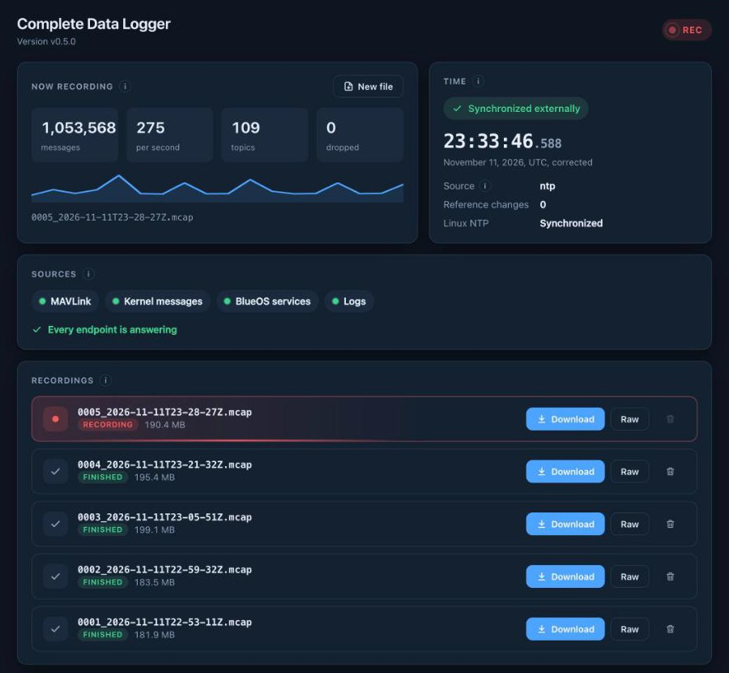

<p align="center"></p>

# Single File Logger

A BlueOS extension that records everything the vehicle knows about itself into one [MCAP](https://mcap.dev) file per run: all MAVLink traffic, the state of every BlueOS service, kernel messages, the BlueOS service logs and the logs of every container, extensions included. Open the file in [Foxglove](https://foxglove.dev) or read it with any MCAP library.

Targets BlueOS 1.4.x. Video streams are not recorded, only their configuration.



## Highlights

- **Everything in one file.** Every MAVLink message from every component, the state of every BlueOS service, kernel messages, the BlueOS service logs and the logs of every container, extensions included, side by side on one timeline.
- **Time you can trust, and know when not to.** Every message carries the monotonic time it arrived, which never jumps, so relative timing is always right. It also carries a `time_synced_externally` flag that says whether its absolute UTC time comes from NTP or the autopilot, or only from the vehicle's own clock. Each clock change is recorded with its exact step.
- **Synchronized after the fact.** Download re-stamps the whole run with the best time reference it reached, including what was recorded before the clock was synced.
- **No more space than it needs.** Large state, like the bag of holding, is written only when it changes, and small recurring data, like CPU and temperature, is written every poll. The file is compressed. The page shows how fast the file grows and how long until the disk limit; recording pauses at 95% disk use so the vehicle never runs out of space.
- **Other services can log into it.** Any extension or topside service can send its own data over a WebSocket, synced to the same clock, and it lands in the same file.
- **Record what matters.** Start a new file the moment the useful part begins, and set how often each service is polled.
- **Safe for the vehicle.** It only reads from BlueOS, a power cut loses at most the last 5 seconds, and a clock step can't crash it or reorder its data.
- **Never fails silently.** A service that goes down, a link that stays connected but goes quiet, a source that crashes, a failing SD card: each keeps everything else recording, shows on the page, is written into the file, and recovers on its own. See [When something fails](#when-something-fails).

## What is recorded

| Topic | Source | When |
|---|---|---|
| `/mavlink/<sysid>/<compid>/<MESSAGE>` | mavlink2rest websocket, every message from every component | as it arrives |
| `/blueos/system-information/system/{cpu,memory,temperature,network}` | linux2rest | every second |
| `/blueos/system-information/system/disk` | linux2rest | every 5 s |
| `/blueos/kraken/v1.0/stats` (per-container CPU and memory) | kraken | every 10 s |
| `/blueos/system-information/system/process` | linux2rest | every 10 s |
| `/blueos/...` for bag of holding, autopilot manager, beacon, bridget, cable-guy, commander, helper, kraken, camera manager, NMEA injector, ping, version chooser, wifi manager | each service's REST API | polled, written only when the answer changes |
| `/linux/kernel` | linux2rest kernel buffer websocket, from boot | as it arrives |
| `/blueos/logs/<service>` | `/var/logs/blueos/services`, one message per line, files written since boot read from the start (`backfill: true`) | as written |
| `/docker/logs/<container>` | every container, BlueOS core and all extensions, through BlueOS's read-only Docker proxy, from boot (`backfill: true` for lines from before the logger started) | as written |
| `/time/linux_clock_set`, `/time/linux_ntp`, `/time/sync` | the clock itself (see below) | on change |
| `/logger/events` | the logger itself: connections, pauses, crashes | on change |
| `/logger/unparsed/<source>` | a message a source sent that the logger didn't understand, kept as it came | as it arrives |
| `/logger/overflow` | messages of new topics once a file has 10,000 topics (see below) | as it arrives |

A service that stops answering is recorded too: its topic gets `{"error": "..."}` until it comes back.

Keys that look like credentials (`password`, `token`, `secret`, `api_key`, ...) are replaced with `<redacted>`, since logs get shared.

## Time

Every message is wrapped like this, the same model ArduPilot uses in its dataflash logs (`TimeUS` on every message, `RTC` records for each clock set):

```json
{"mono_ns": ..., "wall_ns": ..., "corrected_ns": ..., "time_synced_externally": true, "time_source": "ntp", "data": {...}}
```

- **`mono_ns`**: `CLOCK_MONOTONIC` when the message arrived. Never jumps, restarts at every boot.
- **`wall_ns`**: Linux wall clock when the message arrived, i.e. what the system believed at that moment.
- **`corrected_ns`**: `mono_ns + shift`, the best estimate of UTC. `shift` maps monotonic time to UTC, like ArduPilot's `rtc_shift`.
- **`time_synced_externally`**: whether `corrected_ns` comes from an external source. `false` means it is only what Linux believed, which on a Raspberry Pi without internet can be days off (fake-hwclock).
- **`time_source`**: where `corrected_ns` comes from, best first:
  1. `ntp`: the Linux clock while NTP keeps it synchronized.
  2. `autopilot`: the autopilot's `SYSTEM_TIME`, once it has a valid time (GPS, or a ground station's time when `BRD_RTC_TYPES` allows it). ArduPilot never moves its clock backwards, so a bad push from a topside can leave it wrong while NTP has already fixed Linux; that's why it ranks below NTP. If `BRD_RTC_TYPES` lets the autopilot take the host clock at boot, this can be the Pi's own unsynced time.
  3. `linux_unsynced`: the Linux clock, with nothing external behind it.

  A worse source never replaces a better one. On a Navigator, ArduPilot writes its time into the Linux clock, so `autopilot` and the Linux clock agree.

### Download: one file, all of it synchronized

**Download** on the extension page gives every message of the run the best reference the run reached, including messages recorded before the sync. That is possible because `mono_ns` never jumps within a boot, so one shift is right for all of them. For the same reason, a file closed before the sync (with New file, say) gets the better reference reached later in the same boot. In that file `corrected_ns` is the MCAP `log_time`, every message carries the same `time_synced_externally` and `time_source`, and the `time` metadata says which reference was used. This is the file to analyze.

**Download as recorded**, in the menu next to Download, gives the file exactly as it was written, without that correction: messages from before the clock sync keep the absolute time the vehicle believed then. There `corrected_ns` is the best reference known at the moment of each message, and the MCAP `log_time` is `mono_ns` placed at the best time known when the file started, so it never jumps and never reorders even when the clock is stepped. MCAP readers sort by `log_time`, so a wall-clock `log_time` would put stepped data in the wrong place.

### Clock records

- **`/time/linux_clock_set`**: every time anything sets the Linux clock (ArduPilot through the Navigator HAL, `commander/set_time`, NTP stepping it), with the exact step, of any size. Detected by the kernel (`timerfd` with `TFD_TIMER_CANCEL_ON_SET`), not by polling. Gradual NTP slewing is not a set and is not recorded.
- **`/time/linux_ntp`**: whether the kernel considers the Linux clock synchronized, on every change.
- **`/time/sync`**: every change of the reference, with `source`, `synced`, `shift_ns`, `previous_shift_ns` and `step_ns`.

Nothing in the logger reads the wall clock to measure time or name files it depends on, so a clock step can't crash it, reorder its data or overwrite a file. `mono_ns` follows NTP slewing (only `CLOCK_MONOTONIC_RAW` doesn't), which is what keeps `corrected_ns` on UTC between syncs.

## Using it

The extension page shows the recording live (message rate, topics, the corrected UTC clock, whether the time is synchronized externally and from which source, and any endpoint that is failing) and lists recordings, which you can download with the time correction applied to the whole run, or as recorded from the menu next to Download (the active one too, up to its last 5 seconds) or delete once finished. One corrected download is prepared at a time, so the vehicle keeps a core for recording.

**New file** closes the current file and continues in a new one from that moment, so a recording can start where the useful data does, with nothing to trim. The new file is complete on its own: it starts with the time reference in use, so it is synchronized from its first message if the vehicle already was, and the state of every service is written again at its start. The same is available as `POST /new_file`.

**Stop** is for emergencies, like a card running out of space or misbehaving: it closes the current file whole and records nothing, not even into a new file, until **Start**, which continues in a new file. Messages not recorded meanwhile are counted as dropped. A stop is not kept across restarts, so a reboot never leaves a run unrecorded. A stopped file can be deleted to free space. The same is available as `POST /stop` and `POST /start`.

**Polling rates** sets how often each BlueOS service is asked for its state. Edit as many as you like; nothing changes until you press **Apply**, which saves them (they survive restarts) and starts a new file, so every file has one set of rates, recorded in its `poll_periods_s` metadata. Going faster than the default makes the file bigger and can be more than a service keeps up with, so the page warns about it: test before relying on it. Endpoints written only on change cost almost nothing to poll often; the ones written at every poll grow the file with every poll. Also available as `GET /settings` and `POST /settings` with `{"poll_periods": {"<path>": <seconds>}}`. Files live in `/usr/blueos/extensions/complete-data-logger` on the vehicle and are numbered, so their order holds even when the clock that named them was wrong.

Recording pauses while the disk is over 95% full or has less than 1 GB free, so the vehicle never runs out of space, and resumes on its own. The page shows how fast the file grows and, at that rate, how long until the disk reaches the limit. An hour takes roughly 50 MB.

If the vehicle loses power, the file has no index and the last few seconds are lost: what is in memory is written and synced to the card every 5 seconds. Download still works on such a file, and `mcap recover <file>` rebuilds its index for other tools.

## When something fails

The logger is meant to be trusted, so no failure stops it quietly. Each case below keeps every other source recording, shows on the page (in the list of what is failing, the source chips or the state badge), is written into the file, and recovers on its own.

| What happens | What the logger does |
|---|---|
| A BlueOS service stops answering, or answers with an error | Its topic gets `{"error": "..."}`, it is listed as failing, and it is cleared and recorded again when it answers. Polls run in their own threads, so a stalled service never delays the others. |
| BlueOS core restarts | The links show *reconnecting*, and MAVLink and kernel messages are recorded again within 2 s of it being back. |
| MAVLink is connected but nothing arrives (autopilot off, serial link lost) | The MAVLink chip turns yellow after 5 s and says for how long. Messages the autopilot numbered but that never arrived are counted too. |
| A source sends a message the logger doesn't understand | Kept in `/logger/unparsed/<source>`; the connection carries on. |
| Part of the logger crashes | That part restarts after 5 s, the crash is in `/logger/events` and on the page, and everything else keeps recording. |
| The SD card fails to write (I/O error, read-only remount) | The page shows **NOT RECORDING** with the error. The file is never written again after a failure, so what it already has stays readable; a new file is tried every 10 s, and recording continues in it as soon as the card allows. |
| The disk is almost full | Recording pauses at 95% use or under 1 GB free, and resumes on its own. On resume, every state that is only written on change is written again. |
| An extension creates topics without end (an id in the name) | Past 10,000 topics in one file, new topics go to `/logger/overflow`, still recorded, instead of breaking the file. |
| A chunk of a finished file is damaged | Download skips that chunk only, and says what was skipped in the file's `export_problems` metadata. |
| The extension is stopped or updated | The file is closed whole within a second of the stop, well before Docker's 10 s limit. |

## Logging from other services and extensions

Any service can add its own data to the recording, with the same synchronized time, over a WebSocket on port `9651` (`ws://blueos.local:9651`). Messages are JSON objects with an `op`:

| `op` | Send | Reply |
|---|---|---|
| `hello` | `{"op": "hello", "name": "my-extension"}` | none. Names your topics; send it first. |
| `sync` | `{"op": "sync", "t0": <your clock, ns>}` | `{"op": "sync", "t0", "mono_ns", "corrected_ns", "shift_ns", "time_synced_externally", "time_source"}` |
| `log` | `{"op": "log", "topic": "sonar/depth", "data": {...}, "mono_ns": <our monotonic, ns>}` | none, or an `error` |

Stamp each message with **our** monotonic time, at the moment it happened, not when you send it:

1. Sync: send `t0` (your monotonic clock), get our `mono_ns`, note the arrival time `t2`. Then `offset = mono_ns - (t0 + t2) / 2`, and the round trip `t2 - t0` bounds the error. Repeat a few times and keep the shortest round trip.
2. Log with `mono_ns = your monotonic time when it happened + offset`. Leave `mono_ns` out and the time of arrival is used instead.
3. Re-sync now and then: two monotonic clocks drift apart slowly.

Monotonic, not corrected time, because it never jumps: whatever happens to the clocks later, the logger maps it to UTC on download like everything else. An extension on the same vehicle shares the kernel's monotonic clock (Docker gives containers no offset), so its offset comes out near zero; the sync still guards against a container with a time namespace offset, and it is what makes a service on another computer, like the topside, work too.

Messages land on `/extensions/<name>/<topic>`, with `received_mono_ns` next to `mono_ns`; a client can't write outside its own namespace. `mono_ns` in the future (beyond one second) or over 10 minutes old is refused, and so is everything while recording is paused; each refusal gets an `error` reply and shows on the page. `NaN` and `Infinity`, which no JSON reader accepts, are recorded as `null`. `example_client.py` does all of this in about 40 lines.

## Settings

Environment variables, all optional: `MAX_DISK_USE_PERCENT` (default `95`), `MIN_FREE_MB` (`1024`), `PORT` (`9650`), `INGEST_PORT` (`9651`), `BLUEOS_HOST` (`127.0.0.1`, change it to run the logger off-vehicle).

## Development

```sh
pip install -r requirements.txt
python test_main.py  # unit tests: each README promise and each failure above
python test_e2e.py   # the real logger against a fake BlueOS, ~30 s
docker build -t complete-data-logger . && docker run --rm -e BLUEOS_HOST=<vehicle ip> -p 9650:9650 complete-data-logger
```
